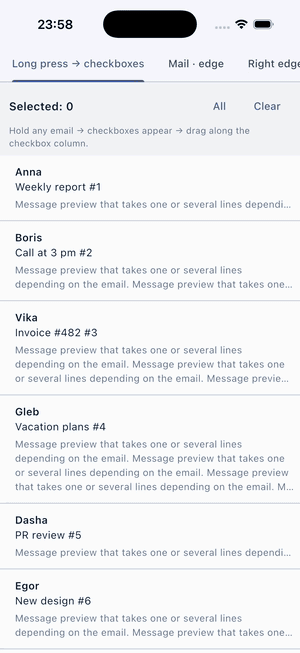
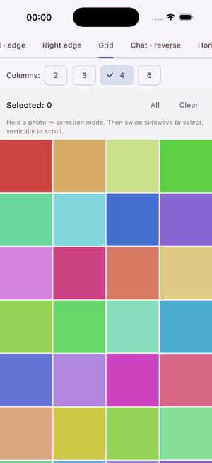
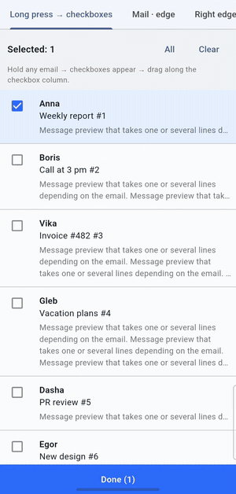
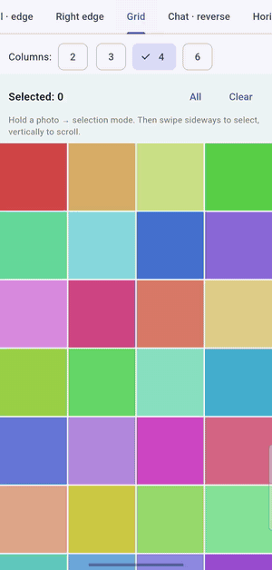
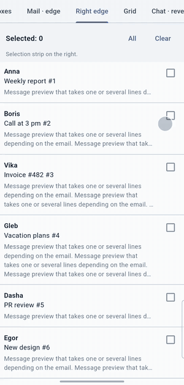
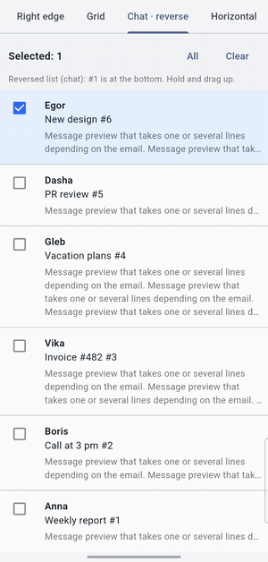
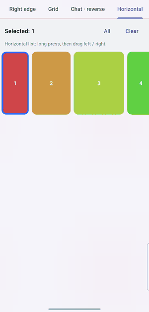

<h1 align="center">swipe_select</h1>

<p align="center">
  <b>Swipe to multi-select for Flutter lists and grids.</b><br>
  Hold, drag your finger, and every item under it gets selected. The list auto-scrolls at the edges.
</p>

<p align="center">
  <a href="https://pub.dev/packages/swipe_select"></a>
  
  <a href="https://github.com/Mironlive/swipe_select/blob/main/LICENSE"></a>
</p>

<table align="center">
  <tr><th colspan="2">iOS</th><th colspan="2">Android</th></tr>
  <tr>
    <td></td>
    <td></td>
    <td></td>
    <td></td>
  </tr>
</table>

<p align="center">English · <a href="https://github.com/Mironlive/swipe_select/blob/main/README.ru.md">Русский</a></p>

- **Lists first.** Mail, chats, tasks, files — `ListView`, `GridView`, `CustomScrollView` slivers. Items of any size.
- **Three ways to start, combinable:** an edge strip (mail apps), long press (Gmail, Photos), swipe across (iOS Photos select mode).
- **Chats and carousels.** `reverse: true` and horizontal lists just work.
- **Feels native.** Auto-scroll ramps up towards the edge. Moving back restores what was there before the gesture.
- **Taps stay yours.** A tap in the strip goes to your checkbox, a drag goes to the gesture — no double toggles.
- **Cheap rebuilds.** `SwipeSelectItem.builder` rebuilds only the rows whose selection changed.
- **Plays well with your state.** `onChanged` fires once per gesture — easy to sync with Bloc / Riverpod.
- **Pure Dart.** No platform code, no dependencies.

> Also available for [React Native](https://www.npmjs.com/package/@mironlive/react-native-swipe-select), [SwiftUI](https://github.com/Mironlive/swipe-select-swiftui) and [Jetpack Compose](https://github.com/Mironlive/swipe-select-compose).

## Installation

```bash
flutter pub add swipe_select
```

## Quick start

```dart
import 'package:flutter/material.dart';
import 'package:swipe_select/swipe_select.dart';

class Inbox extends StatefulWidget {
  const Inbox({super.key, required this.mails});
  final List<Mail> mails;

  @override
  State<Inbox> createState() => _InboxState();
}

class _InboxState extends State<Inbox> {
  final controller = SwipeSelectController<String>();

  @override
  void dispose() {
    controller.dispose();
    super.dispose();
  }

  @override
  Widget build(BuildContext context) {
    final mails = widget.mails;
    return SwipeSelect<String>(
      controller: controller,
      itemCount: mails.length,
      keyForIndex: (i) => mails[i].id,
      child: ListView.builder(
        itemCount: mails.length,
        itemBuilder: (context, i) => SwipeSelectItem(
          index: i,
          builder: (context, selected) => ListTile(
            leading: Checkbox(value: selected, onChanged: (_) => controller.toggle(mails[i].id)),
            title: Text(mails[i].subject),
            tileColor: selected ? Colors.blue.shade50 : null,
          ),
        ),
      ),
    );
  }
}
```

Three rules:

1. Wrap the scroll view with `SwipeSelect` and pass the same `itemCount`.
2. Wrap **every item** with `SwipeSelectItem(index: i, …)` — that's how the widget knows where items are.
3. `keyForIndex` returns a stable key (usually the id). The selection holds keys, so it survives pagination and sorting.

By default you tap the first checkbox to enter selection mode, then drag along the 56 px strip on the left.

## How the gesture starts — `activation`

```dart
// Edge strip (default). Like mail apps.
activation: const [SwipeSelectActivation.edge(side: EdgeSide.start, size: 56)],

// Long press anywhere on an item. Like Gmail / Photos. No selection mode needed.
activation: const [SwipeSelectActivation.longPress(duration: Duration(milliseconds: 300))],

// Swipe across the list. Like iOS Photos: sideways selects, vertical scrolls.
activation: const [SwipeSelectActivation.pan(distance: 10)],
```

| | `edge` | `longPress` | `pan` |
| --- | --- | --- | --- |
| Where | strip at the edge | the whole item | the whole item |
| Starts | after the finger moves 4 px | after holding | on a swipe across the list |
| Default `when` | `selectionMode` | `always` | `selectionMode` |
| Scrolling | outside the strip | until the hold | along the list |

`when`: `ActivationWhen.always`, `.selectionMode` (only while selecting) or `.idle` (only outside selection mode).

### Combine them

Like iOS Mail — no checkboxes at first, a long press anywhere enters selection mode, then you drag along the checkbox column:

```dart
activation: const [
  SwipeSelectActivation.longPress(when: ActivationWhen.idle), // outside selection mode
  SwipeSelectActivation.edge(),                               // inside selection mode
],
```

A photo grid without a "Select" button:

```dart
activation: const [
  SwipeSelectActivation.longPress(when: ActivationWhen.idle), // hold a photo — selection mode, keep dragging
  SwipeSelectActivation.pan(),                                // then: sideways selects, vertical scrolls
],
```

Hiding checkboxes outside selection mode is your UI: `controller.isSelectionMode`.

**Selection mode** is on while something is selected. If your app has a "Select" button, set `controller.selectionMode = true`.

## Your own state (Bloc, Riverpod…)

```dart
final controller = SwipeSelectController<String>(
  initialSelection: state.selectedIds,
  onChanged: (ids, reason) => context.read<MailCubit>().setSelected(ids),
);

// When your store changes from the outside:
controller.sync(state.selectedIds); // no onChanged call
```

- During a gesture the controller notifies listeners on every change (rows update live), but `onChanged` fires **once**, when the gesture ends.
- `toggle`, `select`, `deselect`, `setSelection`, `selectAll`, `clear` also call `onChanged`; `reason` tells you why: `gesture`, `toggle` or `api`.

## Lists

| | |
| --- | --- |
| `ListView` / `ListView.separated` | works as is |
| `GridView` | selection is linear by index, like in Photos |
| `CustomScrollView` with `SliverList` / `SliverGrid` | works as is |
| `reverse: true` (chats) | works as is — auto-scroll goes to older items |
| `scrollDirection: Axis.horizontal` | works as is; the edge strip runs along the top / bottom |
| RTL | `EdgeSide.start` follows the text direction |

## What the selection holds

Keys from `keyForIndex`. A key can be anything: `String`, `int`, a record. `controller.selected` is a `Set<K>`.

```dart
final ids = controller.selected;          // Set<String>
final mails = widget.mails.where((m) => controller.isSelected(m.id)).toList();
```

## Customization

```dart
SwipeSelect<String>(
  // …
  autoScroll: const SwipeSelectAutoScroll(edgeSize: 80, minSpeed: 150, maxSpeed: 1400),
  // autoScroll: SwipeSelectAutoScroll.disabled,
  isSelectable: (i) => !mails[i].locked,     // skipped while swiping
  enabled: !isEditing,                       // turn the gesture off
  onDragStart: (e) => HapticFeedback.mediumImpact(),
  onItemEnter: (e) => HapticFeedback.selectionClick(), // on every new item under the finger
  onDragEnd: (e) => print(e.selected),
  child: …,
)
```

The package draws nothing: checkboxes, highlights, counters and toolbars are yours. Use `controller.isSelectionMode`, `controller.isDragging`, `controller.selectedCount`.

Highlight the edge zone while the list auto-scrolls:

```dart
ValueListenableBuilder<int>(
  valueListenable: controller.autoScrollDirection, // -1 towards the top / left, 0, 1 towards the bottom / right
  builder: (context, direction, _) => AnimatedOpacity(opacity: direction == 1 ? 1 : 0, duration: const Duration(milliseconds: 150), child: const BottomGlow()),
)
```

## API

### `SwipeSelect<K>`

| Parameter | Type | Default | |
| --- | --- | --- | --- |
| `controller` | `SwipeSelectController<K>` | — | holds the selection |
| `itemCount` | `int` | — | number of items |
| `keyForIndex` | `K Function(int)` | — | stable key of an item |
| `child` | `Widget` | — | the scroll view |
| `activation` | `List<SwipeSelectActivation>` | `[edge()]` | how the gesture starts |
| `isSelectable` | `bool Function(int)?` | all | non-selectable items are skipped |
| `autoScroll` | `SwipeSelectAutoScroll` | `(60, 120, 900)` | edge zone px, min / max speed px/s |
| `enabled` | `bool` | `true` | turn the gesture off |
| `onDragStart` / `onItemEnter` / `onDragEnd` | callbacks | — | key, index, mode (`select` / `deselect`) |

### `SwipeSelectController<K>`

`selected` (an unmodifiable view, no copying), `selectedCount`, `isSelected(key)`, `isSelectionMode`, `selectionMode` (force on / off), `isDragging`, `autoScrollDirection` (`ValueListenable<int>`), `toggle`, `select`, `deselect`, `setSelection`, `selectAll(keys)`, `clear`, `sync(keys)`, `onChanged`.

### `SwipeSelectItem`

`SwipeSelectItem(index: i, child: …)` or `SwipeSelectItem(index: i, builder: (context, selected) => …)`.

## Performance

Lazy lists stay lazy: only mounted items are registered, so even with 10,000 items the widget checks the 20–40 rows on screen. Items that scrolled away still get selected — by index, through `keyForIndex`.

| When | What the package does |
| --- | --- |
| At rest | nothing — the auto-scroll ticker is stopped |
| Finger moves | checks the bounds of the mounted items |
| Finger enters a new item | applies only the difference between ranges; only rows whose selection changed rebuild |
| Auto-scroll | `ScrollPosition.jumpTo` once per frame |
| Gesture ends | one `onChanged` |

CPU of the example app, profile build on an Android emulator (relative numbers — the emulator measures the host CPU):

| Scenario | CPU |
| --- | --- |
| At rest, list on screen | 0.2% |
| Plain scrolling, no gesture | 9.8% |
| Drag-select with continuous auto-scroll | 16.5% |

## How it works

- Every `SwipeSelectItem` registers its render box. Under the finger, the widget checks the real bounds of the mounted items — any size, grids, separators (the nearest item wins).
- The gesture competes with the list's own scroll in Flutter's gesture arena: the edge strip claims the pointer after 4 px (the list needs 18 px), long press after the hold, swipe-across when the finger moves across first.
- Selection is a transition between ranges `[anchor..finger]`: entering the range applies the mode, leaving it restores the snapshot taken when the gesture started.
- Auto-scroll runs on a `Ticker` and `ScrollPosition.jumpTo`, respecting `reverse` and the axis.
- If the data changes mid-gesture (a new email at the top), the anchor and range are remapped by key.

## Limitations

- Index order must match visual order (regular lists and grids). Masonry layouts aren't supported.
- One `SwipeSelect` per scroll view; nested scrollables inside items aren't supported.

## Example

[`example/`](https://github.com/Mironlive/swipe_select/tree/main/example) has six scenarios: long press → checkboxes, mail with a left strip (locked items, incoming mail during a gesture), right strip, photo grid (10,000 items, 2–6 columns), chat (`reverse`), horizontal list.

```bash
cd example && flutter run
```

More scenarios on Android: right edge strip, chat (`reverse`), horizontal list.

<p align="center">
  
  
  
</p>

## Author

Made by Mironov · [@Mironlive](https://github.com/Mironlive)

## License

MIT
