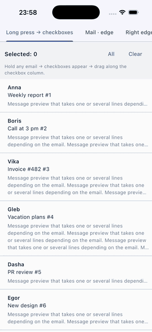
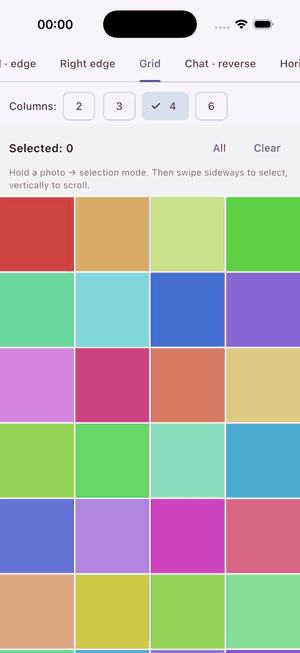
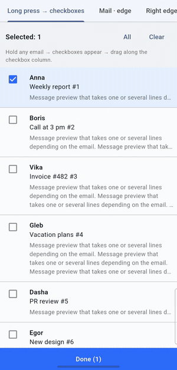
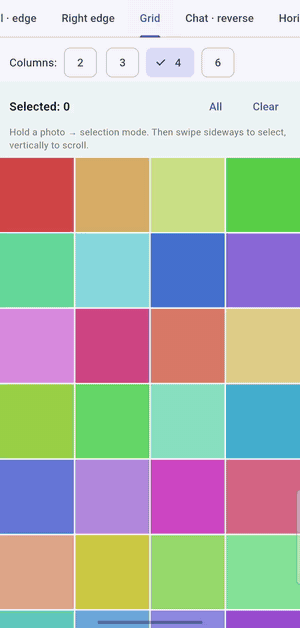
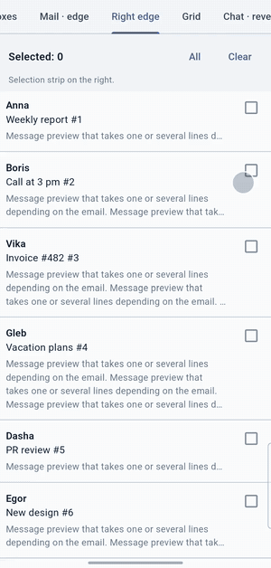
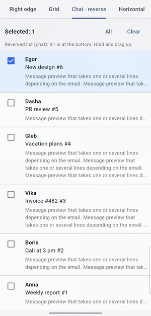
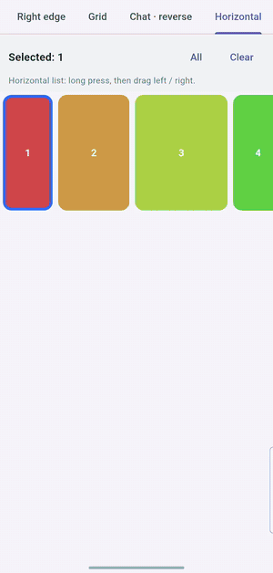

<h1 align="center">swipe_select</h1>

<p align="center">
  <b>Выбор элементов списка и сетки свайпом для Flutter.</b><br>
  Зажал, провёл пальцем — и всё, что под ним, отмечается. У края список сам прокручивается.
</p>

<p align="center">
  <a href="https://pub.dev/packages/swipe_select"></a>
  
  <a href="https://github.com/Mironlive/swipe_select/blob/main/LICENSE"></a>
</p>

<table align="center">
  <tr><th colspan="2">iOS</th><th colspan="2">Android</th></tr>
  <tr>
    <td></td>
    <td></td>
    <td></td>
    <td></td>
  </tr>
</table>

<p align="center"><a href="https://github.com/Mironlive/swipe_select#readme">English</a> · Русский</p>

- **В первую очередь списки.** Почта, чаты, задачи, файлы — `ListView`, `GridView`, слайверы `CustomScrollView`. Элементы любого размера.
- **Три способа начать жест, можно комбинировать:** полоса у края (почтовые клиенты), долгое нажатие (Gmail, «Фото»), свайп поперёк (режим выбора в «Фото» iOS).
- **Чаты и карусели.** `reverse: true` и горизонтальные списки работают из коробки.
- **Ощущается нативно.** Автоскролл ускоряется к краю. Движение назад возвращает то, что было до жеста.
- **Тапы остаются твоими.** Тап в полосе достаётся твоему чекбоксу, драг — жесту. Двойного переключения нет.
- **Дешёвые перестройки.** `SwipeSelectItem.builder` перестраивает только строки, у которых изменилась отметка.
- **Дружит с твоим стейтом.** `onChanged` вызывается один раз за жест — легко синхронизировать с Bloc / Riverpod.
- **Чистый Dart.** Без платформенного кода и зависимостей.

> Есть и для React Native: [`@mironlive/react-native-swipe-select`](https://www.npmjs.com/package/@mironlive/react-native-swipe-select).

## Установка

```bash
flutter pub add swipe_select
```

## Быстрый старт

```dart
import 'package:flutter/material.dart';
import 'package:swipe_select/swipe_select.dart';

class Inbox extends StatefulWidget {
  const Inbox({super.key, required this.mails});
  final List<Mail> mails;

  @override
  State<Inbox> createState() => _InboxState();
}

class _InboxState extends State<Inbox> {
  final controller = SwipeSelectController<String>();

  @override
  void dispose() {
    controller.dispose();
    super.dispose();
  }

  @override
  Widget build(BuildContext context) {
    final mails = widget.mails;
    return SwipeSelect<String>(
      controller: controller,
      itemCount: mails.length,
      keyForIndex: (i) => mails[i].id,
      child: ListView.builder(
        itemCount: mails.length,
        itemBuilder: (context, i) => SwipeSelectItem(
          index: i,
          builder: (context, selected) => ListTile(
            leading: Checkbox(value: selected, onChanged: (_) => controller.toggle(mails[i].id)),
            title: Text(mails[i].subject),
            tileColor: selected ? Colors.blue.shade50 : null,
          ),
        ),
      ),
    );
  }
}
```

Три правила:

1. Оберни скролл в `SwipeSelect` и передай тот же `itemCount`.
2. Оберни **каждый элемент** в `SwipeSelectItem(index: i, …)` — так виджет узнаёт, где элементы.
3. `keyForIndex` возвращает стабильный ключ (обычно id). Выбор хранит ключи, поэтому переживает пагинацию и сортировку.

По умолчанию первый элемент отмечаешь тапом по чекбоксу, дальше ведёшь пальцем по полосе шириной 56 px слева.

## Как начинается жест — `activation`

```dart
// Полоса у края (по умолчанию). Как в почтовых клиентах.
activation: const [SwipeSelectActivation.edge(side: EdgeSide.start, size: 56)],

// Долгое нажатие в любом месте элемента. Как в Gmail / «Фото». Режим выбора не нужен.
activation: const [SwipeSelectActivation.longPress(duration: Duration(milliseconds: 300))],

// Свайп поперёк списка. Как «Фото» iOS: поперёк — выделение, вдоль — скролл.
activation: const [SwipeSelectActivation.pan(distance: 10)],
```

| | `edge` | `longPress` | `pan` |
| --- | --- | --- | --- |
| Где | полоса у края | весь элемент | весь элемент |
| Старт | после сдвига пальца на 4 px | после удержания | при свайпе поперёк списка |
| `when` по умолчанию | `selectionMode` | `always` | `selectionMode` |
| Скролл | вне полосы | до удержания | вдоль списка |

`when`: `ActivationWhen.always`, `.selectionMode` (только в режиме выбора) или `.idle` (только вне режима выбора).

### Несколько способов сразу

Как в iOS Mail — сначала чекбоксов нет, долгое нажатие в любом месте включает режим выбора, дальше ведёшь по колонке чекбоксов:

```dart
activation: const [
  SwipeSelectActivation.longPress(when: ActivationWhen.idle), // вне режима выбора
  SwipeSelectActivation.edge(),                               // в режиме выбора
],
```

Галерея без кнопки «Выбрать»:

```dart
activation: const [
  SwipeSelectActivation.longPress(when: ActivationWhen.idle), // удержал фото — режим выбора, можно сразу вести
  SwipeSelectActivation.pan(),                                // дальше: поперёк — выделение, вдоль — скролл
],
```

Прятать чекбоксы вне режима выбора — это твой UI: `controller.isSelectionMode`.

**Режим выбора** включён, пока что-то выбрано. Если в приложении есть кнопка «Выбрать», поставь `controller.selectionMode = true`.

## Свой стейт (Bloc, Riverpod…)

```dart
final controller = SwipeSelectController<String>(
  initialSelection: state.selectedIds,
  onChanged: (ids, reason) => context.read<MailCubit>().setSelected(ids),
);

// Если стор поменялся снаружи:
controller.sync(state.selectedIds); // без вызова onChanged
```

- Во время жеста контроллер уведомляет слушателей на каждом изменении (строки обновляются вживую), но `onChanged` вызывается **один раз**, когда жест заканчивается.
- `toggle`, `select`, `deselect`, `setSelection`, `selectAll`, `clear` тоже вызывают `onChanged`; `reason` говорит, откуда изменение: `gesture`, `toggle` или `api`.

## Списки

| | |
| --- | --- |
| `ListView` / `ListView.separated` | работает как есть |
| `GridView` | выделение линейное по индексу, как в «Фото» |
| `CustomScrollView` со `SliverList` / `SliverGrid` | работает как есть |
| `reverse: true` (чаты) | работает как есть — автоскролл идёт к старым элементам |
| `scrollDirection: Axis.horizontal` | работает как есть; полоса идёт вдоль верхнего / нижнего края |
| RTL | `EdgeSide.start` следует направлению текста |

## Что хранит выбор

Ключи из `keyForIndex`. Ключом может быть что угодно: `String`, `int`, record. `controller.selected` — это `Set<K>`.

```dart
final ids = controller.selected;          // Set<String>
final mails = widget.mails.where((m) => controller.isSelected(m.id)).toList();
```

## Кастомизация

```dart
SwipeSelect<String>(
  // …
  autoScroll: const SwipeSelectAutoScroll(edgeSize: 80, minSpeed: 150, maxSpeed: 1400),
  // autoScroll: SwipeSelectAutoScroll.disabled,
  isSelectable: (i) => !mails[i].locked,     // пропускаются при свайпе
  enabled: !isEditing,                       // выключить жест
  onDragStart: (e) => HapticFeedback.mediumImpact(),
  onItemEnter: (e) => HapticFeedback.selectionClick(), // на каждом новом элементе под пальцем
  onDragEnd: (e) => print(e.selected),
  child: …,
)
```

Пакет ничего не рисует: чекбоксы, подсветка, счётчики и тулбары — твои. Используй `controller.isSelectionMode`, `controller.isDragging`, `controller.selectedCount`.

## API

### `SwipeSelect<K>`

| Параметр | Тип | По умолчанию | |
| --- | --- | --- | --- |
| `controller` | `SwipeSelectController<K>` | — | хранит выбор |
| `itemCount` | `int` | — | число элементов |
| `keyForIndex` | `K Function(int)` | — | стабильный ключ элемента |
| `child` | `Widget` | — | скролл |
| `activation` | `List<SwipeSelectActivation>` | `[edge()]` | как начинается жест |
| `isSelectable` | `bool Function(int)?` | все | невыбираемые пропускаются |
| `autoScroll` | `SwipeSelectAutoScroll` | `(60, 120, 900)` | зона у края px, мин. / макс. скорость px/с |
| `enabled` | `bool` | `true` | выключить жест |
| `onDragStart` / `onItemEnter` / `onDragEnd` | колбэки | — | ключ, индекс, режим (`select` / `deselect`) |

### `SwipeSelectController<K>`

`selected` (неизменяемое представление, без копирования), `selectedCount`, `isSelected(key)`, `isSelectionMode`, `selectionMode` (включить / выключить принудительно), `isDragging`, `autoScrollDirection` (`ValueListenable<int>`), `toggle`, `select`, `deselect`, `setSelection`, `selectAll(keys)`, `clear`, `sync(keys)`, `onChanged`.

### `SwipeSelectItem`

`SwipeSelectItem(index: i, child: …)` или `SwipeSelectItem(index: i, builder: (context, selected) => …)`.

## Производительность

Ленивые списки остаются ленивыми: регистрируются только отрисованные элементы, поэтому даже при 10 000 элементов виджет проверяет 20–40 строк на экране. Строки, ушедшие за экран, всё равно отмечаются — по индексу через `keyForIndex`.

| Когда | Что делает пакет |
| --- | --- |
| В покое | ничего — тикер автоскролла остановлен |
| Палец двигается | проверяет границы отрисованных элементов |
| Палец на новом элементе | применяет только разницу диапазонов; перестраиваются только строки, где изменилась отметка |
| Автоскролл | `ScrollPosition.jumpTo` раз в кадр |
| Конец жеста | один `onChanged` |

CPU example-приложения, profile-сборка на Android-эмуляторе (цифры относительные — эмулятор меряет CPU хоста):

| Сценарий | CPU |
| --- | --- |
| Покой, список на экране | 0,2% |
| Обычный скролл, без жеста | 9,8% |
| Выделение с непрерывным автоскроллом | 16,5% |

Подсветить зону у края во время автоскролла: `controller.autoScrollDirection` — `ValueListenable<int>` (-1 к верху / левому краю, 0, 1 к низу / правому).

## Как это работает

- Каждый `SwipeSelectItem` регистрирует свой render box. Под пальцем виджет проверяет реальные границы отрисованных элементов — любой размер, сетки, разделители (берётся ближайший элемент).
- Жест соревнуется со скроллом списка на «арене» жестов Flutter: полоса забирает касание после 4 px (скроллу нужно 18 px), long press — после удержания, свайп поперёк — если палец сначала ушёл поперёк.
- Выбор — переход между диапазонами `[якорь..палец]`: вошёл в диапазон — применяется режим, вышел — восстанавливается снимок на старте жеста.
- Автоскролл крутится на `Ticker` через `ScrollPosition.jumpTo` и учитывает `reverse` и ось.
- Если данные меняются посреди жеста (новое письмо сверху), якорь и диапазон переносятся по ключам.

## Ограничения

- Порядок индексов должен совпадать с визуальным (обычные списки и сетки). Masonry-раскладки не поддерживаются.
- Один `SwipeSelect` на один скролл; вложенные скроллы внутри элементов не поддерживаются.

## Пример

В [`example/`](https://github.com/Mironlive/swipe_select/tree/main/example) шесть сценариев: long press → чекбоксы, почта с полосой слева (недоступные письма, входящие во время жеста), полоса справа, сетка фото (10 000 элементов, 2–6 колонок), чат (`reverse`), горизонтальный список.

```bash
cd example && flutter run
```

Ещё сценарии на Android: полоса справа, чат (`reverse`), горизонтальный список.

<p align="center">
  
  
  
</p>

## Автор

Mironov · [@Mironlive](https://github.com/Mironlive)

## Лицензия

MIT
